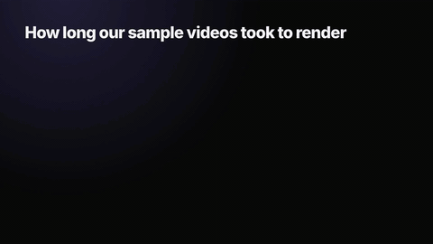
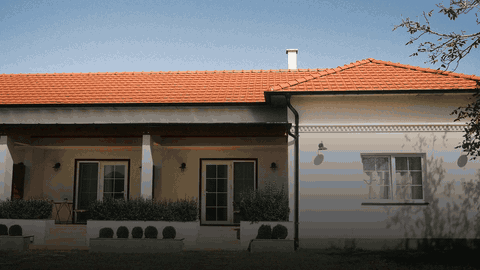

# Glidezo skills: free video and image skills for coding agents

Nine free agent skills that make videos and images in code. Your agent (Claude Code, Codex, Cursor, Gemini CLI and
others) writes an HTML composition and renders it on your computer with [HyperFrames](https://github.com/heygen-com/hyperframes).
No API key, no cost per video: a 6-second title renders in about 15 seconds on a 4-core computer.


Each skill is a folder with a `SKILL.md` (the instructions your agent reads) and a zero-dependency Node script that
turns a small JSON file into a finished MP4 or PNG. Your agent collects your text, screenshots or photos, writes the
JSON, checks the composition and renders it. You can also run every script by hand.

## Install

**Claude Code** (plugin marketplace, one line per skill, Claude Code 2.1.275 or later):

```bash
/plugin install launch-video --marketplace glidezo/skills
/plugin install kinetic-type-title --marketplace glidezo/skills
/plugin install animated-captions --marketplace glidezo/skills
/plugin install logo-reveal --marketplace glidezo/skills
/plugin install data-chart-video --marketplace glidezo/skills
/plugin install device-mockup-promo --marketplace glidezo/skills
/plugin install real-estate-slideshow-maker --marketplace glidezo/skills
/plugin install og-image --marketplace glidezo/skills
/plugin install youtube-thumbnail --marketplace glidezo/skills
```

On older versions, add the marketplace once with `/plugin marketplace add glidezo/skills`, then
`/plugin install launch-video@glidezo`.

**Any agent** (Claude Code, Codex, Cursor, Gemini CLI, OpenCode and more) with the open
[`skills`](https://github.com/vercel-labs/skills) CLI:

```bash
npx skills add glidezo/skills                        # pick skills and agents from a list
npx skills add glidezo/skills --skill launch-video   # one skill
```

**By hand:** copy a folder from `skills/` into your agent's skills folder.

| Agent | Personal skills folder | Project skills folder |
|---|---|---|
| Claude Code | `~/.claude/skills/` | `.claude/skills/` |
| Codex | `~/.agents/skills/` | `.agents/skills/` |
| Cursor | `~/.cursor/skills/` or `~/.agents/skills/` | `.cursor/skills/` or `.agents/skills/` |
| Gemini CLI | `~/.gemini/skills/` or `~/.agents/skills/` | `.gemini/skills/` or `.agents/skills/` |

Then just ask: *"Make a launch video for my app from these screenshots."*

**Needs:** Node.js 22+ and FFmpeg on your PATH. HyperFrames downloads its own headless Chrome the first time it runs.

## The skills

Every sample below was made by the skill itself, from our own screenshots, data or openly licensed footage.

### Video

| Skill | What you give it | What you get |
|---|---|---|
| [Launch Video](skills/launch-video) | Product name, 1 to 6 features with screenshots, a call to action | 15 to 40 s launch or promo video (sample: 23 s, rendered in about 80 s) |
| [Kinetic Type Title](skills/kinetic-type-title) | One line of text | Animated title clip (sample: 6 s in 13 s) |
| [Animated Captions](skills/animated-captions) | A talking video | The same video with word-by-word captions, transcribed on your computer |
| [Logo Reveal](skills/logo-reveal) | Logo file, brand name, tagline | Logo intro or end card (sample: 5 s in 13 s) |
| [Data-Chart Video](skills/data-chart-video) | Labels and numbers | Bar or line chart that grows with counting values (sample: 8 s in 27 s) |
| [Device Mockup Promo](skills/device-mockup-promo) | App or site screenshots | Your screens in a phone or laptop, with captions and a CTA |
| [Real Estate Slideshow Maker](skills/real-estate-slideshow-maker) | Listing photos, price, address, agent | Listing slideshow with price and contact cards |

All video skills render landscape (1920x1080), portrait (1080x1920) or square.

<table>
<tr>
<td width="50%"><b>Kinetic Type Title</b><br></td>
<td width="50%"><b>Animated Captions</b><br></td>
</tr>
<tr>
<td><b>Logo Reveal</b><br></td>
<td><b>Data-Chart Video</b><br></td>
</tr>
<tr>
<td><b>Device Mockup Promo</b><br></td>
<td><b>Real Estate Slideshow Maker</b><br></td>
</tr>
</table>

### Image

| Skill | What you give it | What you get |
|---|---|---|
| [OG Image](skills/og-image) | Page title, optional picture or screenshot | 1200x630 PNG link preview card, checked under 5 MB |
| [YouTube Thumbnail](skills/youtube-thumbnail) | Headline, background picture, optional cut-out | 1280x720 PNG thumbnail, checked under YouTube's 2 MB limit |

<table>
<tr>
<td width="50%"><b>OG Image</b><br></td>
<td width="50%"><b>YouTube Thumbnail</b><br></td>
</tr>
</table>

Full-size samples, inputs and FAQs for each skill are on [glidezo.com/skills](https://glidezo.com/skills).

## How it works

[HyperFrames](https://hyperframes.heygen.com/introduction) (Apache-2.0, by HeyGen) treats a video as an HTML page:
elements carry timing attributes, and GSAP animates them. Its renderer opens the page in headless Chrome, seeks to
each frame, captures it and encodes the frames with FFmpeg, so the same input gives the same video.

Each skill's script writes that HTML from your JSON, then calls a pinned HyperFrames version
(`npx hyperframes@0.8.223`), so a render today matches a render next month. The agent runs `hyperframes check` and
`snapshot` first to catch layout problems before spending a minute on the full render.

## Limitations

- Renders take real time on your machine: about 2 to 5 seconds of rendering per second of 1080p video on a 4-core computer.
- The first run downloads Chrome (through HyperFrames) and, for Animated Captions, a speech model of about 640 MB.
- The looks are fixed templates with your colours, fonts and media. For a different style, ask your agent to edit the HTML.
- Windows support is unit-tested only so far. Bug reports from Windows users are very welcome.

## Run them online

[Glidezo](https://glidezo.com) also has AI model skills you can run in the browser with credits. These nine stay free
here, and their pages on glidezo.com show each sample at full size.

## Licence

MIT, see [LICENSE](LICENSE). The videos and images you make are yours. HyperFrames is Apache-2.0.

Sample media: Animated Captions uses "Timelapse of Clouds over Bellevue Canyon" by Extemporalist (CC0, Wikimedia
Commons) with a voice-over we wrote, spoken by Kokoro-82M (Apache-2.0). The Real Estate Slideshow Maker sample uses
photos by Shixart1985 and Nenad Stojkovic (CC BY 2.0, Wikimedia Commons) and a made-up listing. Everything else shows
our own screenshots, data and logo.
